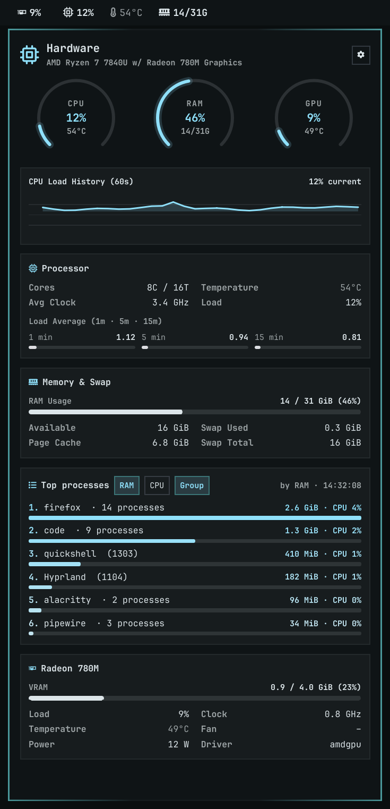

# Hardware Monitor — Omarchy bar widget & system panel

Memory, CPU, and GPU in the bar, with a first-class visual system panel popup. Four readouts, cycled with a right click: sleek icon groups (Noctalia-style), gauges alone, gauges with temperatures, or the numbers spelled out.



Bar sampling reads `/proc` and `/sys` inside the shell process via `FileView` —
no polling script on a timer for that. Two documented helpers do fork: `nvidia-smi`
on the sample interval (NVIDIA cards only — they expose no sysfs telemetry) and
`proc_top.py` up to every 3 s, but only while the system panel is open.

## Install

```sh
omarchy plugin add https://github.com/meviusisback/omarchy-hw-monitor.git --enable
```

Then place it where you want it and restart the shell:

```sh
omarchy bar move meviusisback.hw-monitor --section right --after omarchy.tray
omarchy restart shell
```

Nothing to configure — it finds this machine's sensors on its own.

## Usage

- **Left click** — opens the built-in visual system telemetry panel anchored to the widget (or runs `clickCommand` if configured).
- **Right click** — cycles `icons` → `compact` → `full` → `labels`, and remembers it.
- **Middle click** — resamples immediately.
- **Hover** — says what the clicks do. The full breakdown is a `status` call away (see [IPC](#ipc)).

### The system panel

Clicking the widget opens an Omarchy keyboard-driven popup panel anchored to the bar:

- **Header** — the CPU model, and a gear button (or `s`) that opens the settings drawer.
- **Settings drawer** — chips for the bar readout mode, which items are shown (GPU, CPU, CPU and GPU temperature, RAM, clocks, gauges), RAM format, **°C**/**°F**, and temperature format. Each pick is saved to this widget's entry in `shell.json` at once. The drawer covers the common choices; every key is in [Settings](#settings).
- **Telemetry dials** — 270° circular gauges with live figures for CPU load & temp, RAM usage, and GPU load & temp with dynamic temperature coloring.
- **60s CPU load sparkline** — the last minute of CPU load, recorded on every sample tick in the background (one array push, no extra reads), so the chart is already full when the panel opens. While the panel is open everything samples once a second.
- **Processor details** — full CPU model name (without cutoff), load, clock frequency, dynamic temperature color, and 1m/5m/15m load average meters.
- **Memory breakdown** — used/total GiB visual meter, available, cache, and swap usage.
- **Top processes** — the top processes sorted by RAM or CPU (switch in the header), with share and CPU% per process, blue ramp bars toward the theme accent. The Group toggle collapses them per application (systemd scope, name fallback) with counts, summed CPU and a RAM estimate that counts shared pages once. Sampled only while the panel is open (zero cost while closed).
- **Graphics metrics** — full GPU card name, load, dynamic temperature color, VRAM meter, power draw (W), fan RPM (not on NVIDIA: `nvidia-smi` reports fan speed only as a percentage), and clock speeds.
- **Keyboard navigation** — `Escape` to close, `Tab`/`Shift+Tab` to switch panels, `r` to resample, `c` for °C, `f` for °F, `s` to open or close the settings drawer. With the drawer open, the arrow keys or `h`/`j`/`k`/`l` move between its chips and `Enter` or `Space` picks one.

### The four bar readouts

**`icons`** *(default)* — GPU load, CPU load, CPU temperature with thermometer icon, and RAM (e.g. `󰾲 0%    34%    46°C    11/23G`), ~150px.

**`compact`** — a glyph and a gauge per component, ~80px. The gauge fills from
the bottom and warms toward the theme's urgent colour as load climbs, so the
machine's state is readable without reading a digit.


**`full`** — the same, plus CPU and GPU temperature, ~106px. Memory has no
temperature sensor, so its gauge is the whole readout.


**`labels`** — the Waybar hardware group, tightened: no glyph, no gauge, each
label welded to its figure, ~230px.


## What it reads

| | Source | Shown |
|---|---|---|
| Memory | `/proc/meminfo` | used against total, measured with `MemAvailable` so reclaimable page cache is not counted as used |
| CPU load | `/proc/stat` | jiffie deltas between samples, `iowait` counted as idle — the same arithmetic `top` and `btop` use |
| CPU clock | `/proc/cpuinfo` | mean across every thread |
| CPU temperature | `hwmon` | die/package sensor, picked by scoring (`k10temp` `Tdie`/`Tctl`, `coretemp` `Package id 0`, `zenpower`, ThinkPad, ARM SoC, then `acpitz`) |
| GPU | the card's own `sysfs` | load, edge temperature, VRAM, board power, fan, core clock |
| Load average | `/proc/loadavg` | 1/5/15 minute |

An NVIDIA card is the exception: it reports none of this through sysfs, so it is
polled through `nvidia-smi` on the same interval.

## How it samples

Sensor paths are found once, at load, by [`hw-probe`](hw-probe) — a small shell
script, because working out *which* files a machine exposes means globbing
`hwmon` and matching labels, and every vendor names its sensors differently.
After that the resolved sysfs paths and the fixed `/proc` files need no fork on
a timer the way a Waybar custom module does: the widget reads them directly with
`FileView`, which is what makes a two-second interval reasonable for something
that runs for the life of your session. The documented exceptions are
`nvidia-smi` (NVIDIA cards) and `proc_top.py` (open panel only).

`blockAllReads` is set on those views deliberately. Without it `reload()` is
asynchronous and `text()` returns the *previous* tick's contents, so every
readout lags a full interval. These are kernel-generated files of a few KB, so
a blocking read never stalls the UI.

Run the probe yourself to see what it found:

```sh
~/.config/omarchy/plugins/meviusisback.hw-monitor/hw-probe | jq
```

A sensor missing from that output is one this machine does not expose, and the
widget renders a dash rather than a zero that looks like real data.

## Settings

Settings are read from this widget's entry in `~/.config/omarchy/shell.json`:

```json
{
  "id": "meviusisback.hw-monitor",
  "mode": "icons",
  "refreshIntervalSec": 2,
  "showRam": true,
  "showCpu": true,
  "showGpu": true,
  "ramFormat": "used/total",
  "tempFormat": "degree-unit",
  "fahrenheit": false,
  "warnPercent": 70,
  "criticalPercent": 90,
  "warnTempC": 75,
  "criticalTempC": 90
}
```

Or set dynamically from the command line:

```sh
omarchy bar set meviusisback.hw-monitor mode full
omarchy bar set meviusisback.hw-monitor fahrenheit true --json
```

| Key | Type | Default | Description |
|---|---|---|---|
| `mode` | string | `"icons"` | `"icons"`, `"compact"`, `"full"`, or `"labels"`. Right-clicking cycles them. |
| `itemsOrder` | string | `"gpu,cpu,cpu-temp,ram"` | Comma-separated sequence of telemetry items in the top bar (`"gpu,cpu,cpu-temp,ram"` or `"gpu,cpu,cpu-temp,gpu-temp,ram"`). A JSON array also works. |
| `showGpu` | bool | `true` | Show GPU load (hidden automatically if no card was found). |
| `showCpu` | bool | `true` | Show CPU load. |
| `showCpuTemp` | bool | `true` | Show the standalone CPU temperature cell, with thermometer glyph, in `icons` mode. `full` and `labels` always show the CPU temperature next to its load; `compact` never does. |
| `showGpuTemp` | bool | `false` | Show a standalone GPU temperature cell in `icons` mode. `full` and `labels` always show the GPU temperature next to its load; `compact` never does. |
| `showRam` | bool | `true` | Show memory / RAM usage. |
| `showTopProcs` | bool | `true` | Show the top-processes section in the system panel (sampled only while open). |
| `topProcCount` | int | `6` | How many rows to list (3–12, sorted by the active metric). |
| `topProcSort` | enum | `ram` | Sort top processes by `ram` or `cpu` (switchable in the panel header). |
| `topProcGroup` | bool | `true` | Collapse processes by application (systemd scope, name fallback) with counts, summed CPU and a RAM estimate that counts shared pages once. |
| `ramFormat` | string | `"used/total"` | `"used/total"` (`12/23G`), `"used"` (`12.3G`), `"percent"` (`52%`), or `"free"` (`11.1G`: `MemAvailable`, what a new program can use without swapping). `"available"` is accepted as another name for `"free"`. |
| `tempFormat` | string | `"degree-unit"` | `"degree-unit"` (`45°C`), `"degree"` (`45°`), `"unit"` (`45C`), `"unit-lower"` (`45c`), or `"bare"` (`45`). |
| `fahrenheit` | bool | `false` | Temperatures in °F instead of °C. |
| `percentPad` | string | mode-dependent | `"none"` (`3%`), `"zero"` (`03%`, the zero at `padOpacity`), or `"lead"` (` 3%`). Unset, it is `"none"` in `icons` and `"zero"` in `compact`/`full`/`labels`. Figure cells always reserve their slot width, so neighbours stay put in every mode. The retired `"trail"` (and `"space"`) read as `"none"`. |
| `showGauges` | bool | mode-dependent | Show vertical capsule gauges. Unset, they are on in `compact`/`full` and off in `icons`/`labels`. A set value overrides the mode, but the `labels` readout never draws gauges. |
| `showValues` | bool | `false` | Put percentages back on the row beside each gauge in `compact`/`full` modes. (`icons` and `labels` always show them). |
| `showClocks` | bool | `false` | Show CPU and GPU clock speeds in GHz. A vertical bar (position left or right) draws no clocks; the setting is kept and applies again on a horizontal bar. |
| `gpuIcon` | string | `"󰾲"` | Glyph marking the GPU figure. |
| `cpuIcon` | string | `""` | Glyph marking the CPU figure. |
| `tempIcon` | string | `""` | Glyph marking the CPU temperature figure. |
| `gpuTempIcon` | string | `"󰔏"` | Glyph marking the GPU temperature figure. |
| `ramIcon` | string | `""` | Glyph marking the RAM figure. |
| `clockIcon` | string | `"󰓅"` | Glyph marking the clock figure. Empty draws the number alone. |
| `gpuIconRotation` | int | `0` | Rotate the GPU glyph, in degrees (-360 to 360). |
| `cpuIconRotation` | int | `0` | Rotate the CPU glyph, in degrees (-360 to 360). |
| `tempIconRotation` | int | `0` | Rotate the CPU temperature glyph, in degrees (-360 to 360). |
| `gpuTempIconRotation` | int | `0` | Rotate the GPU temperature glyph, in degrees (-360 to 360). |
| `ramIconRotation` | int | `0` | Rotate the RAM glyph, in degrees (-360 to 360). The clock glyph has no rotation key. |
| `padOpacity` | number | `0.3` | Opacity (0–1) of the leading zero drawn when `percentPad` is `"zero"`. |
| `iconSize` | int | `0` | Overall scale in pixels. `0` follows the bar's icon font. |
| `refreshIntervalSec` | int | `2` | Seconds between samples. `1` is as fast as `FileView` makes sense; `5` is plenty for a background bar. |
| `gpu` | string | `"auto"` | `"auto"` picks the first card the probe lists: cards with a load counter sort first, NVIDIA cards last. Otherwise an index into that list (`0`, `1`: a position, not the DRM card number) or a case-insensitive substring of the card, driver or name (`"card1"`, `"amdgpu"`, `"9070"`); an exact card name wins over a substring match. A number outside the list is matched as a substring like any other value (that is how `"9070"` works), and only a value that matches nothing falls back to `"auto"` rather than hiding the GPU. |
| `warnPercent` | int | `70` | Load threshold where numbers and glyphs warm toward the urgent colour. |
| `criticalPercent` | int | `90` | Load threshold where the gauge glows and color reaches full urgent. |
| `warnTempC` | int | `75` | Temperature threshold (°C) where figures warm toward urgent. |
| `criticalTempC` | int | `90` | Temperature threshold (°C) where temperature turns hot urgent red. |
| `clickCommand` | string | `""` | Command to run on left click. Empty opens the built-in system panel popup. |
| `monitors` | string | `""` | Comma-separated connector names to draw on (e.g. `"DP-1,HDMI-A-1"`). A JSON array also works. Empty draws on all screens. For a different readout per screen, see the note below on placing the widget more than once. |

**Placing the widget more than once.** Each placement draws and samples on its
own, so two entries can show a different `mode` on different `monitors`. But
the shell saves settings by widget id: anything saved from the widget (right
click, the panel's settings drawer, top-process chips and `c`/`f` keys, and the
`cycleMode` and `toggleFahrenheit` IPC calls) writes that placement's whole
entry, `monitors` included, onto every placement in `shell.json`. Edit
placements that should differ by hand in `shell.json` and don't change them
from the widget afterwards. For the same settings on several screens, use one
placement with `monitors`.

## IPC

Call methods through `omarchy-shell`:

```sh
# Open the system telemetry popup
omarchy-shell meviusisback.hw-monitor open

# Close the system panel
omarchy-shell meviusisback.hw-monitor close

# show / hide are aliases of open / close, the stock Omarchy panel verbs
omarchy-shell meviusisback.hw-monitor show
omarchy-shell meviusisback.hw-monitor hide

# Toggle the system panel popup
omarchy-shell meviusisback.hw-monitor toggle

# Toggle Celsius / Fahrenheit
omarchy-shell meviusisback.hw-monitor toggleFahrenheit

# Cycle the display mode
omarchy-shell meviusisback.hw-monitor cycleMode

# Force an immediate resample
omarchy-shell meviusisback.hw-monitor refresh

# Dump the full multi-line telemetry breakdown
omarchy-shell meviusisback.hw-monitor status
```

## Requirements

- A Nerd Font for the glyphs, which Omarchy already ships
- `pciutils` (`lspci`) — optional, only to name the GPU card in the panel
- `nvidia-smi` — only for NVIDIA cards, installed with the driver
- `python3` (`/usr/bin/python3`) — only for the top-processes panel section; the section shows a fallback message when absent

No pip packages, no daemon, no elevated privileges. Data sources: `/proc` and
`/sys` via `FileView`, plus the optional helpers above — and `clickCommand`, which
runs an arbitrary user-configured shell command on left click when set (empty by
default, which opens the built-in panel instead).

## Removal

```sh
omarchy plugin remove meviusisback.hw-monitor
```

That drops it from the bar and deletes the plugin. Per-widget settings live in
the shell's own config (`~/.config/omarchy/shell.json`) and are left for the
shell to prune — remove the widget's entry there if you want a clean slate.

## Development

Run the checks before you push:

```sh
scripts/check.sh
```

It validates the manifest the way `omarchy plugin add` does, checks that the
manifest `defaults` match the schema, and syntax-checks `hw-probe`,
`proc_top.py`, `Model.js` and the QML files. `shellcheck` and `pyflakes` also
run when installed.

To try uncommitted changes in your own bar, link your checkout in place of the
installed copy. Parking the installed copy under a dot-name keeps it out of the
shell's plugin scan, and your bar entry and its settings stay as they are. Run
this from the checkout:

```sh
plugins=~/.config/omarchy/plugins
mv "$plugins/meviusisback.hw-monitor" "$plugins/.meviusisback.hw-monitor.orig" &&
  ln -s "$PWD" "$plugins/meviusisback.hw-monitor"
```

The shell's file watcher does not follow the link, so reload after each edit:

```sh
omarchy-shell shell rescanPlugins
```

To go back, remove the link, move the `.orig` folder back to its name, and
rescan. Do that before running `omarchy plugin update`, which would otherwise
treat your checkout as the installed plugin and try to fast-forward it from its
`origin`.

On a machine without the plugin installed, you can install the checkout itself
instead: `omarchy plugin add "$PWD" --enable` once, then
`omarchy plugin update meviusisback.hw-monitor --yes` after each commit. That
validates the new commit, rolls back one that fails, and reloads the shell.

To cut a release, list the changes under Unreleased in
[CHANGELOG.md](CHANGELOG.md) and run `scripts/release.sh X.Y.Z`. It bumps the
manifest version, runs the checks, and commits and tags locally; pushing is up
to you.

The `.beads/`, `.agents/`, `.claude/`, `.codex/` and `.cursor/` folders,
`AGENTS.md` and `CLAUDE.md` are contributor tooling for the beads issue tracker
and coding agents. The plugin loads none of it, and it does nothing unless you
open a coding agent in the plugin folder and trust it, or run `bd` there.

## License

MIT — see [LICENSE](LICENSE). Original work by Edgar Silva; continued and
extended by meviusisback.

## Credits

Based on [Edgar Silva's omarchy-hw-monitor](https://github.com/edgarsilva/omarchy-hw-monitor)
(MIT). This fork continues the plugin — the original repository has been
inactive since August 2026 — with the Noctalia-style readout, the visual
system panel, and per-widget settings. The original MIT license is preserved;
copyright lines in [LICENSE](LICENSE) reflect both authors.
